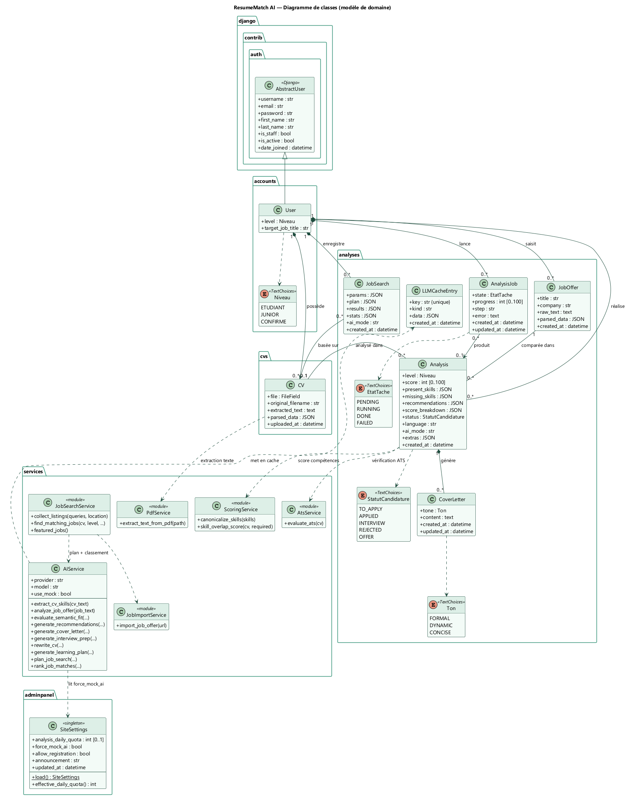
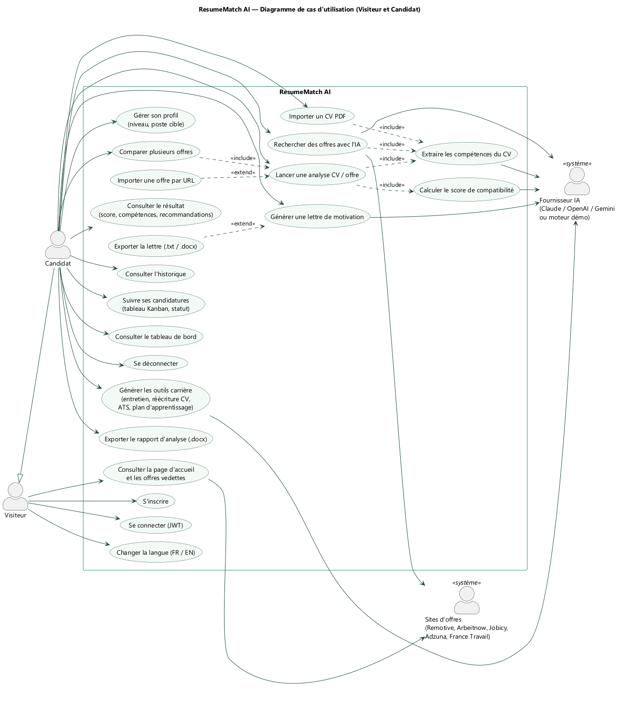
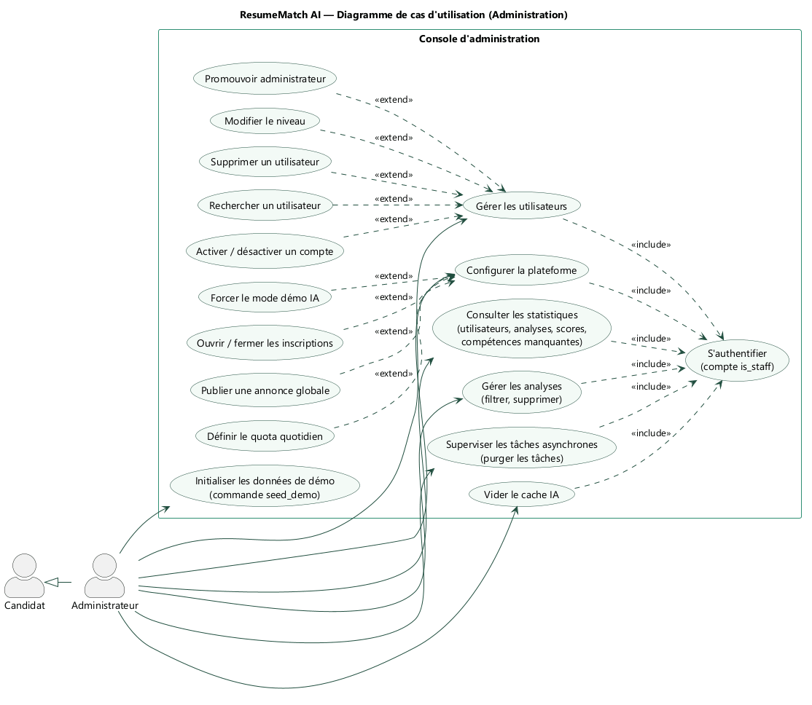
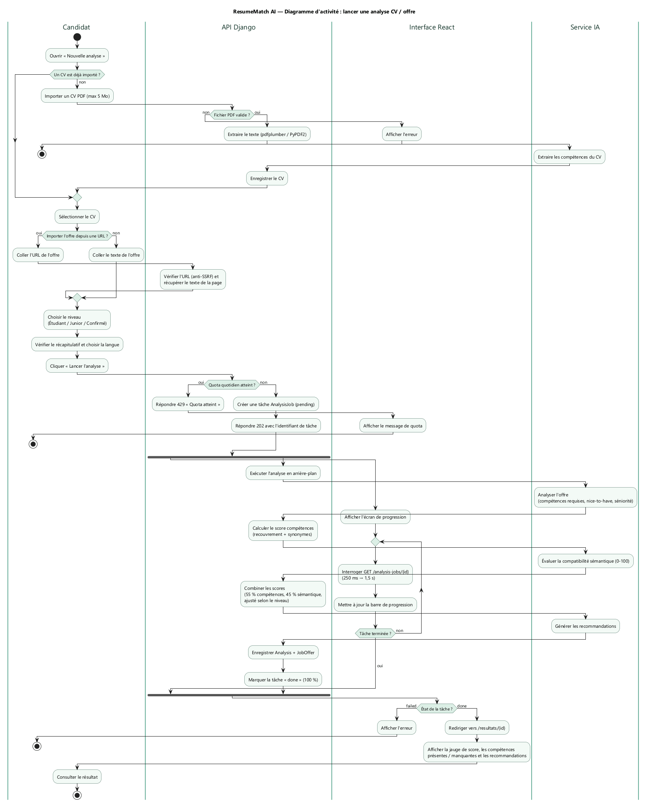
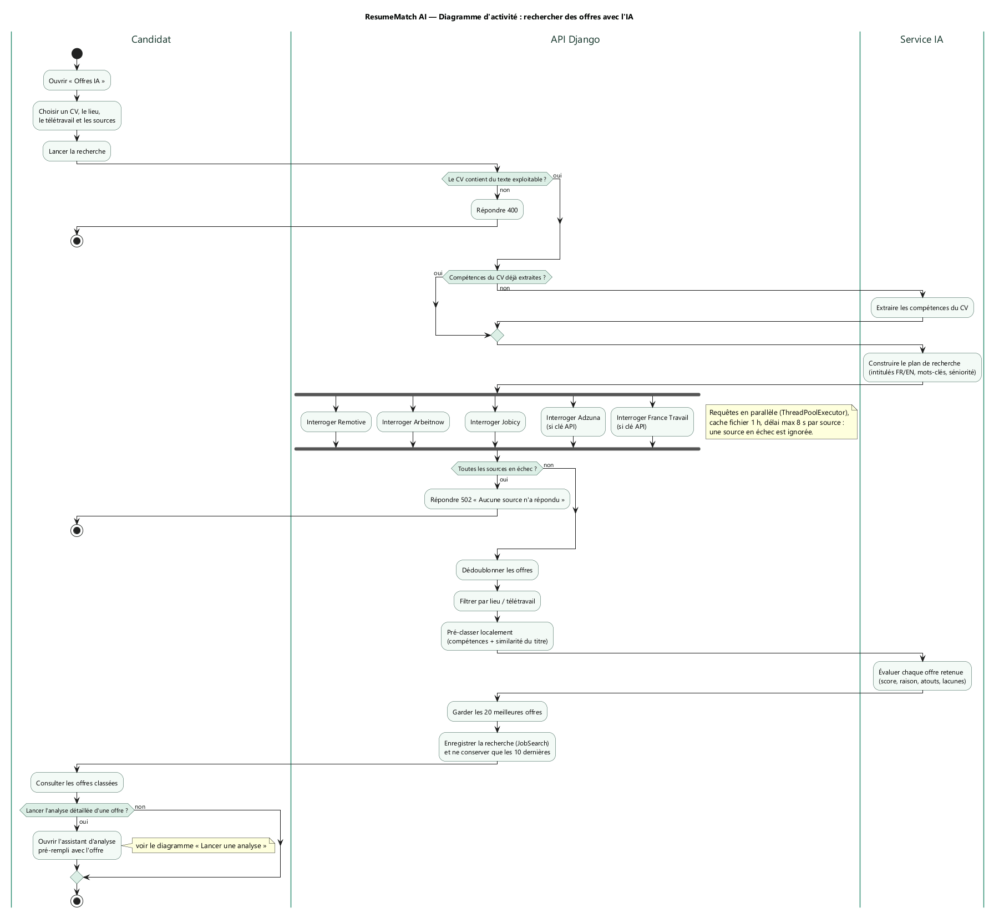
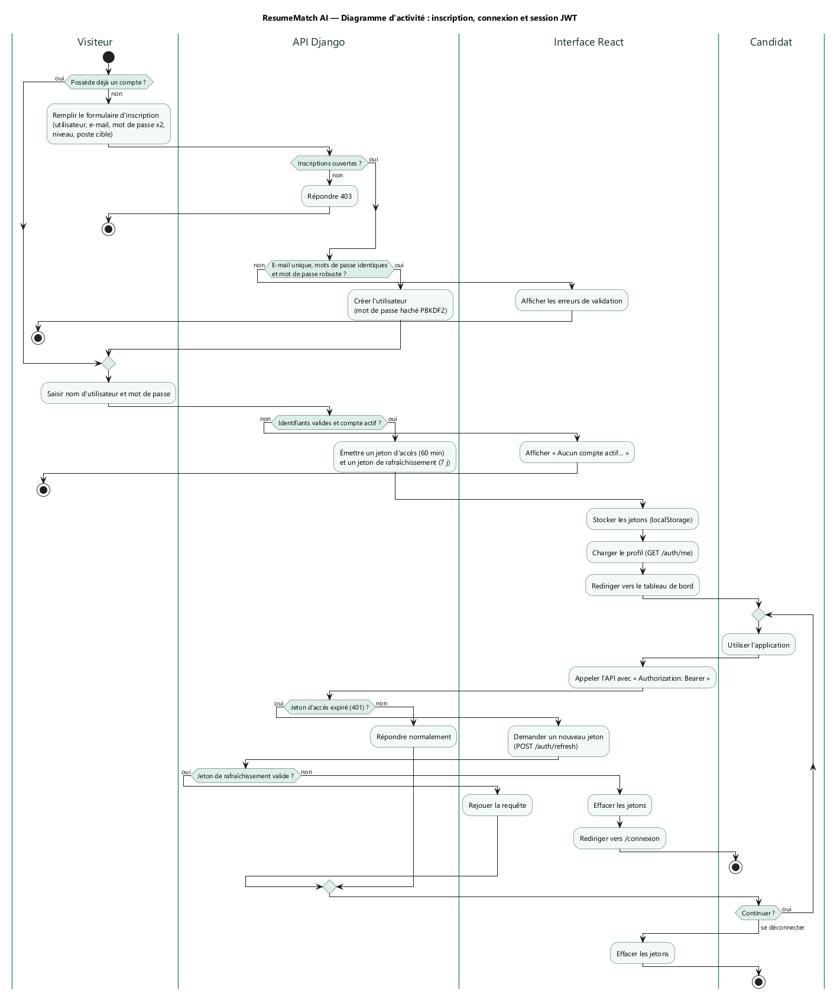

# ResumeMatch AI — Dossier de conception UML

Ce dossier présente la modélisation UML de ResumeMatch AI (équipe CVisionnaires AI) : diagramme de classes, diagrammes de cas d'utilisation et diagrammes d'activité. Les diagrammes ont été produits avec **PlantUML** à partir du code réel de l'application (modèles Django, vues API, services et interface React).

Les prompts utilisés pendant la création de l'application sont regroupés dans le document **PROMPTS.md** du même dossier.

| Diagramme | Type UML | Source PlantUML | Image |
|---|---|---|---|
| Modèle de domaine | Classes | `diagrammes/01-diagramme-classes.puml` | `images/diagramme-classes.png` |
| Visiteur et Candidat | Cas d'utilisation | `diagrammes/02-cas-utilisation-candidat.puml` | `images/cas-utilisation-candidat.png` |
| Administration | Cas d'utilisation | `diagrammes/03-cas-utilisation-administration.puml` | `images/cas-utilisation-administration.png` |
| Lancer une analyse | Activité | `diagrammes/04-activite-analyse.puml` | `images/activite-analyse.png` |
| Rechercher des offres | Activité | `diagrammes/05-activite-recherche-offres.puml` | `images/activite-recherche-offres.png` |
| Authentification et session | Activité | `diagrammes/06-activite-authentification.puml` | `images/activite-authentification.png` |

---

## 1. Diagramme de classes



Le modèle de domaine correspond aux modèles Django des applications `accounts`, `cvs`, `analyses` et `adminpanel`, complétés par la couche `services`.

| Classe | Rôle |
|---|---|
| `User` | Hérite de `AbstractUser` (Django) ; ajoute le niveau (Étudiant / Junior / Confirmé) et le poste cible |
| `CV` | Fichier PDF importé, texte extrait et compétences structurées (`parsed_data`) |
| `JobOffer` | Offre d'emploi saisie ou importée par URL, avec son analyse structurée |
| `Analysis` | Confrontation d'un CV et d'une offre : score 0-100, compétences présentes / manquantes, recommandations, statut de candidature (Kanban) et outils carrière (`extras`) |
| `CoverLetter` | Lettre de motivation générée pour une analyse, dans un ton donné |
| `AnalysisJob` | Tâche asynchrone d'analyse (pending → running → done / failed) avec progression |
| `JobSearch` | Recherche d'offres par l'IA : paramètres, plan, résultats classés (10 dernières conservées) |
| `LLMCacheEntry` | Cache des réponses du LLM (clé unique = empreinte du prompt) |
| `SiteSettings` | Singleton de configuration : quota quotidien, mode démo forcé, inscriptions, annonce |
| `AIService` | Service IA indépendant du fournisseur, validation Pydantic et repli sur un moteur mock |

**Relations principales :**

- un utilisateur possède (composition) ses CV, offres, analyses, tâches et recherches : leur suppression suit celle du compte ;
- une analyse relie exactement un CV et une offre ; un CV ou une offre peut servir à plusieurs analyses ;
- une analyse peut produire plusieurs lettres de motivation (tons différents, régénérations) ;
- une tâche asynchrone produit au plus une analyse ; une recherche d'offres s'appuie sur au plus un CV.

---

## 2. Diagrammes de cas d'utilisation

### 2.1 Visiteur et Candidat



| Acteur | Description |
|---|---|
| Visiteur | Utilisateur non connecté : consulte la page d'accueil, s'inscrit, se connecte, change la langue |
| Candidat | Utilisateur connecté (hérite du Visiteur) : utilise toutes les fonctionnalités d'analyse |
| Fournisseur IA | Système externe : Claude, OpenAI, Gemini ou moteur démo hors ligne |
| Sites d'offres | Systèmes externes : Remotive, Arbeitnow, Jobicy, Adzuna, France Travail |

**Relations remarquables :**

- *Lancer une analyse* **inclut** l'extraction des compétences et le calcul du score ;
- *Importer une offre par URL* **étend** le lancement d'une analyse (option) ;
- *Comparer plusieurs offres* **inclut** une analyse par offre ;
- *Exporter la lettre* **étend** la génération de la lettre de motivation ;
- *Rechercher des offres avec l'IA* **inclut** l'extraction des compétences et sollicite les deux systèmes externes.

### 2.2 Administration



L'**Administrateur** hérite du Candidat : il dispose de toutes les fonctionnalités candidat, plus la console d'administration. Chaque cas d'administration **inclut** l'authentification avec un compte `is_staff`. La gestion des utilisateurs (recherche, activation, promotion, niveau, suppression) et la configuration de la plateforme (quota, mode démo, inscriptions, annonce) sont modélisées comme des **extensions**.

---

## 3. Diagrammes d'activité

Les diagrammes d'activité utilisent des **couloirs (swimlanes)** pour montrer qui réalise chaque action : le candidat, l'interface React, l'API Django ou le service IA.

### 3.1 Lancer une analyse CV / offre



Étapes clés :

- import et validation du CV PDF (5 Mo maximum), extraction du texte puis des compétences par l'IA ;
- offre collée ou importée par URL (protection anti-SSRF) ;
- vérification du quota quotidien : réponse **429** si atteint ;
- création d'une tâche `AnalysisJob` et réponse **202** immédiate ;
- **en parallèle** : l'API exécute l'analyse en arrière-plan (analyse de l'offre, score compétences, score sémantique, combinaison 55 % / 45 % ajustée selon le niveau, recommandations) pendant que l'interface interroge la tâche avec un intervalle croissant (250 ms → 1,5 s) ;
- redirection vers la page de résultats ou affichage de l'erreur.

### 3.2 Rechercher des offres avec l'IA



Étapes clés :

- contrôle du texte du CV (réponse **400** s'il est vide) et réutilisation des compétences déjà extraites ;
- construction par l'IA d'un plan de recherche (intitulés FR / EN, mots-clés, séniorité) ;
- interrogation **en parallèle** des 5 sources (cache d'une heure, 8 s maximum par source, une source en échec est ignorée) ; réponse **502** si toutes échouent ;
- dédoublonnage, filtrage par lieu / télétravail, pré-classement local puis classement par l'IA ;
- conservation des 20 meilleures offres et enregistrement de la recherche (10 dernières conservées) ;
- possibilité d'ouvrir l'assistant d'analyse pré-rempli avec une offre.

### 3.3 Inscription, connexion et session JWT



Étapes clés :

- inscription : contrôle de l'ouverture des inscriptions (**403** si fermées), validation (e-mail unique, mots de passe identiques et robustes), mot de passe haché en PBKDF2 ;
- connexion : émission d'un jeton d'accès (60 min) et d'un jeton de rafraîchissement (7 jours), stockés dans le navigateur ;
- à chaque appel, si le jeton d'accès a expiré (**401**), l'interface demande un nouveau jeton et rejoue la requête ; si le jeton de rafraîchissement est invalide, elle efface la session et redirige vers la connexion ;
- déconnexion : suppression des jetons.

---

## 4. Régénérer les diagrammes

Prérequis : Java 17 ou plus et `plantuml.jar` (aucune installation de Graphviz nécessaire, le moteur intégré *smetana* est utilisé).

```text
cd docs/conception/diagrammes
java -jar plantuml.jar -charset UTF-8 -tpng -o ../images *.puml
java -jar plantuml.jar -charset UTF-8 -tsvg -o ../images *.puml
```
